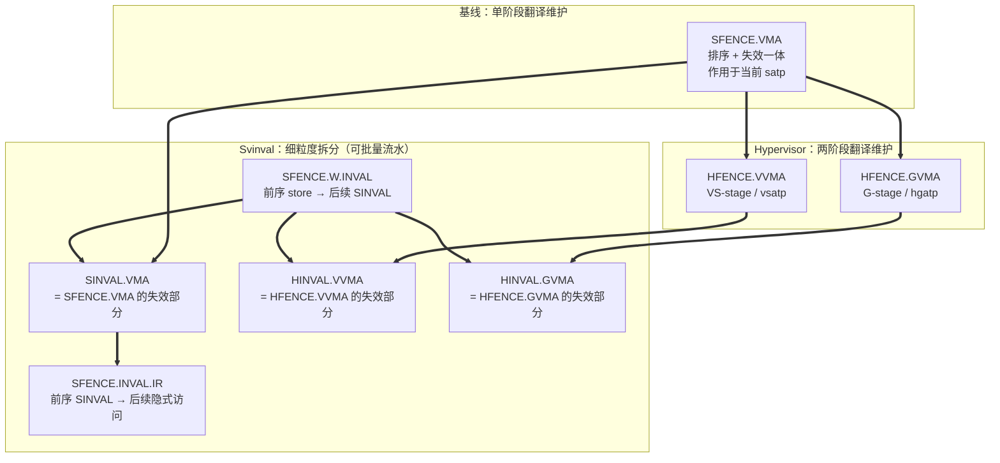
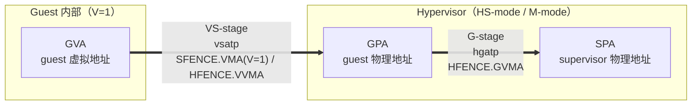
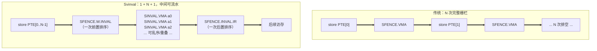
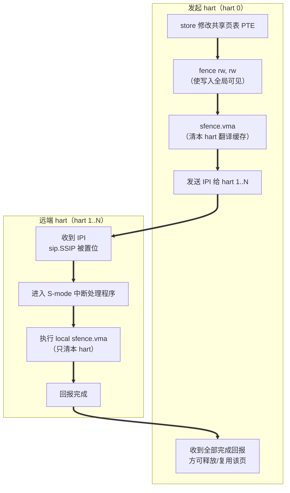

# RISC-V 地址翻译栅栏指令详解：SFENCE.VMA 及其衍生指令

> 本文基于 SPEC 原文编写，主要依据：
> - [SPEC/riscv-isa-manual/src/priv/supervisor.adoc](../../SPEC/riscv-isa-manual/src/priv/supervisor.adoc)（`sfence.vma` 章节）
> - [SPEC/riscv-isa-manual/src/priv/hypervisor.adoc](../../SPEC/riscv-isa-manual/src/priv/hypervisor.adoc)（`hfence.vma`、`hyp-mm-fences` 章节）
> - [SPEC/riscv-isa-manual/src/priv/svinval.adoc](../../SPEC/riscv-isa-manual/src/priv/svinval.adoc)（Svinval 扩展）
> - [SPEC/riscv-isa-manual/src/priv/machine.adoc](../../SPEC/riscv-isa-manual/src/priv/machine.adoc)（`virt-control`、`pmp-vmem`、`menvcfg`）
> - [SPEC/riscv-isa-manual/src/priv/svvptc.adoc](../../SPEC/riscv-isa-manual/src/priv/svvptc.adoc)、[svnapot.adoc](../../SPEC/riscv-isa-manual/src/priv/svnapot.adoc)
>
> 文中引用 SPEC 规范性条款时标注其 `norm:` 标签，便于回溯核对。

---

## 1. 全景总览

`sfence.vma` 并不是一条孤立的指令，而是一个**指令家族**。家族成员按"作用于哪一层地址翻译"和"是完整栅栏还是细粒度拆分"两个维度展开：

| 指令 | 所属扩展 | 作用的翻译层 | 控制 CSR | `rs1` 含义 | `rs2` 含义 |
|------|----------|--------------|----------|-----------|-----------|
| `SFENCE.VMA` | Ss / S-mode 基线 | HS-level（V=0）或 VS-stage（V=1） | `satp` / `vsatp` | 虚拟地址 | ASID |
| `HFENCE.VVMA` | Hypervisor (H) | VS-stage | `vsatp` | guest 虚拟地址 | guest ASID |
| `HFENCE.GVMA` | Hypervisor (H) | G-stage | `hgatp` | guest 物理地址 **>> 2** | VMID |
| `SINVAL.VMA` | Svinval | 同 `SFENCE.VMA` | `satp` / `vsatp` | 虚拟地址 | ASID |
| `HINVAL.VVMA` | Svinval + H | VS-stage | `vsatp` | guest 虚拟地址 | guest ASID |
| `HINVAL.GVMA` | Svinval + H | G-stage | `hgatp` | guest 物理地址 **>> 2** | VMID |
| `SFENCE.W.INVAL` | Svinval | 无（纯排序屏障） | — | `x0` | `x0` |
| `SFENCE.INVAL.IR` | Svinval | 无（纯排序屏障） | — | `x0` | `x1` |

家族关系可概括为下图：



> 注意区分：`FENCE.I`（Zifencei）同步的是**指令流可见性**，`CBO.INVAL/FLUSH/CLEAN`（Zicbom）维护的是**数据缓存**，二者都**不属于**本家族，也不替代地址翻译缓存的维护。

---

## 2. 背景：为什么需要"地址翻译栅栏"

### 2.1 显式访问 vs 隐式访问

开启分页后，一次普通的 `lw`/`sw`/取指会产生两类内存访问：

- **显式访问（explicit access）**：软件直接编写的 load/store/fetch，受 RVWMO 内存模型约束；
- **隐式访问（implicit access）**：硬件页表遍历器（PTW）对页表结构的读写，软件并未显式编写。

SPEC 明确指出（`norm:sfence_vma_op`）：

> 指令执行会导致对这些内存管理数据结构的隐式读写；然而，这些隐式引用**通常不与显式的 load/store 排序**。

这就是问题的根源：**RVWMO 不描述 `SFENCE.VMA` 的行为**（见 [src/unpriv/mm-explanatory.adoc](../../SPEC/riscv-isa-manual/src/unpriv/mm-explanatory.adoc) "Beyond Main Memory" 一节，明确说明 RVWMO 尚未形式化 FENCE.I / SFENCE.VMA / I/O fence / PMA）。因此 `fence rw, rw` **无法**替代 `sfence.vma`。

### 2.2 地址翻译缓存抽象

SPEC 用"地址翻译缓存（address-translation cache）"这一抽象来描述 TLB 及各类动态缓存结构。`sfence.vma` 承担两个职责（`norm:sfence_vma_ordering`、`norm:sfence_vma_invalidation`）：

1. **排序（ordering）**：保证当前 hart 上"此前已可见的 store"先于"后续指令对内存管理数据结构的隐式引用"；
2. **失效（invalidation）**：失效该 hart 地址翻译缓存中匹配的表项。

SPEC 的 NOTE 解释了为何设计成"fence"而非"TLB flush"：

> 把它规定为 fence 而不是 TLB flush，是为了对"哪些指令受 flush 影响"给出更清晰的语义，并支持更广泛的动态缓存结构与内存管理方案。

### 2.3 "最近一次 subsuming SFENCE.VMA"规则（核心语义）

这是理解整个家族最关键的一条（`norm:sfence_vma_ordering_semantics`）：

> 对内存管理数据结构的一次隐式读，**可以返回自"最近一次覆盖（subsume）该地址的 SFENCE.VMA"以来、任意时刻曾经有效过的任一翻译**。

其推论（SPEC NOTE 明确列举）：

- 若修改了 leaf PTE 却在中间**没有**执行 subsuming 的 `SFENCE.VMA`，则新翻译或"自上次 subsuming SFENCE.VMA 以来的任一旧翻译"都可能被采用；**具体选哪个不可预测**，且对同一虚拟地址的后续访问可能使用**不同**的翻译，但行为本身是良定义的（well defined）。
- 该性质**即使翻译所用的虚拟地址位宽与当前 `satp`.MODE 规定的位宽不同也照样适用**——例如从 Sv39 切到 Sv48 后，旧的 Sv39 翻译仍可能被采用。
- 全局映射（G=1）的翻译同理，**无视 ASID 与虚拟地址位宽**。
- 常规 TLB 设计中可能出现"多个表项匹配同一地址"（例如把一页升级为超级页时，未先清除原非叶 PTE 的 V 位并执行 `SFENCE.VMA rs1=x0`）。此时用旧的非叶 PTE 还是新的叶 PTE 不可预测。
- **用宽度小于 PTE 宽度的多条 store 来更新一个 PTE 通常是不安全的**，因为实现有权在任意时刻读取 PTE，包括只有部分 store 生效的中间态。
- SPEC **允许缓存 V=0（无效）的 PTE**。操作系统必须能应对这一点；实现者则被提醒：急切地缓存无效 PTE 会因额外缺页而降低性能。

另外（`norm:sfence_vma_implicit_access`）：实现只允许对"当前 `satp` 指向的翻译结构"或"后续 V=1 的结构项"做隐式读，且只允许对**指令执行实际产生**的隐式访问抛异常，**投机执行**产生的隐式访问不得抛异常。

### 2.4 只作用于本 hart → TLB shootdown

SPEC 强调：`SFENCE.VMA` **只排序本 hart 的隐式引用**。因此修改共享页表后必须单独通知其他 hart，SPEC 给出的四步流程（即 RISC-V 版 TLB shootdown）：

1. 本地 data fence，确保本地写全局可见；
2. 向其他 hart 发送 IPI（核间中断）；
3. 在远端 hart 的中断处理程序里执行本地 `SFENCE.VMA`；
4. 远端回报"操作完成"给发起方。

此外（`norm:asid_hart_private`）：若 hart 使用地址翻译缓存，该缓存**必须表现为该 hart 私有**；ASID 的含义是 hart 本地的，软件可以在不同 hart 上用同一 ASID 指代不同地址空间。

> 多 hart / 多核维度的完整分析（逐条取证、硬件 A/D 更新的唯一例外、SBI RFENCE 委托机制、本框架可测边界）见 **§7**。

---

## 3. SFENCE.VMA 详解

### 3.1 编码

来自 [src/priv/images/bytefield/priv-instr-set.edn](../../SPEC/riscv-isa-manual/src/priv/images/bytefield/priv-instr-set.edn) 与 [wavedrom/sfencevma.edn](../../SPEC/riscv-isa-manual/src/priv/images/wavedrom/sfencevma.edn)：

```
 31      25 24  20 19  15 14  12 11   7 6      0
+-----------+------+------+------+-------+--------+
|  0001001  | rs2  | rs1  | 000  | 00000 | 1110011|
+-----------+------+------+------+-------+--------+
   SFENCE.VMA  asid   vaddr  PRIV    rd=0   SYSTEM

sfence.vma x0, x0  =>  0x12000073
```

汇编支持四种写法：

```asm
sfence.vma              /* rs1=x0, rs2=x0：全量 */
sfence.vma a0           /* rs1=a0, rs2=x0：按地址，所有 ASID */
sfence.vma x0, a1       /* rs1=x0, rs2=a1：按 ASID，所有地址 */
sfence.vma a0, a1       /* rs1=a0, rs2=a1：按地址 + ASID */
```

### 3.2 `rs1`/`rs2` 四种组合的规范语义

这是 `SFENCE.VMA` 的核心（`norm:sfence_vma_all_asid_va` ~ `norm:sfence_vma_va_asid`）：

| `rs1` | `rs2` | 排序范围 | 失效范围 | 全局映射（G=1） |
|-------|-------|----------|----------|-----------------|
| `x0` | `x0` | **所有**地址空间、**任意层级**页表的读写 | **所有**地址翻译缓存表项（所有地址空间） | 一并处理 |
| `x0` | ≠`x0` | 仅 `rs2` 指定 ASID 的、**任意层级**页表的读写 | 匹配该 ASID 的全部表项 | **不排序、不失效**（含全局映射的表项被排除） |
| ≠`x0` | `x0` | 仅对应 `rs1` 虚拟地址的 **leaf PTE** 的读写，所有地址空间 | 含该虚拟地址 leaf PTE 的全部表项，所有地址空间 | 一并处理 |
| ≠`x0` | ≠`x0` | 仅对应 `rs1` 虚拟地址的 **leaf PTE** 的读写，限 `rs2` 指定 ASID | 同时匹配该 VA 与该 ASID 的表项 | **不排序、不失效** |

关键理解点：

- **`rs1=x0` 才覆盖非叶 PTE**。只要修改了非叶 PTE（页表结构变化），就必须 `rs1=x0`；
- **`rs2≠x0` 会排除全局映射**。若遍历路径上任一 PTE 的 G 位被置位，则**必须** `rs2=x0`；
- `rs1≠x0` 时只需给出"落在被修改映射内的任一虚拟地址"，硬件负责覆盖对应的页/超级页。

### 3.3 `rs1` 不是合法虚拟地址

`norm:sfence_vma_invalid_va`：

> 若 `rs1` 中保存的值不是一个合法虚拟地址，则 `SFENCE.VMA` 指令**无任何效果**，且**不抛异常**。

SPEC NOTE 解释了动机：**over-fence 永远合法**——实现可以只依据 `rs1`/`rs2` 的部分位来 fence，甚至把所有 `SFENCE.VMA` 都当作 `rs1=x0`/`rs2=x0` 处理。简单实现完全可以忽略 `rs1` 的虚拟地址和 `rs2` 的 ASID，永远执行全局 fence。不为非法虚拟地址抛异常正是为了方便这种简化。

> **对测试的启示**：不能通过"传入非法地址是否抛异常"来判定实现合规——SPEC 明确规定不抛异常；也不能因为实现忽略了 `rs1`/`rs2` 就判其不合规。

### 3.4 `rs2` 的位域保留规则

`norm:sfence_vma_rs2_bits`：当 `rs2≠x0` 时，

- `rs2` 值的 **bits SXLEN-1:ASIDMAX** 为未来标准用途保留；在标准扩展定义其用途前，**软件应将其清零，当前实现应忽略**；
- 若 **ASIDLEN < ASIDMAX**，实现**必须忽略** `rs2` 值的 bits ASIDMAX-1:ASIDLEN。

### 3.5 特权级与异常

| 执行环境 | 结果 | 依据 |
|----------|------|------|
| U-mode | illegal-instruction 异常 | supervisor-level 指令的通用规则（Svinval 章节对同族指令明确表述为 `norm:Svinval_illegal_instruction_u_mode`） |
| S-mode 且 `mstatus.TVM=1` | illegal-instruction 异常 | `norm:mstatus_tvm_warl_op` |
| VS-mode 且 `hstatus.VTVM=1` | **virtual-instruction** 异常（code 22） | `norm:hstatus_vtvm_op`、`norm:H_virtinst_vs_sfence_sinval_satp_vtvm1` |
| VS-mode 且 `hstatus.VTVM=0` | 正常执行，作用于 `vsatp` | `norm:sfence_vma_v1` |
| S-mode 且 `satp.MODE` 只读为 0（永远 Bare） | **可能**抛 illegal-instruction 异常 | `norm:satp_mode_roz_sfence_illegal` |

关于 `mstatus.TVM`（`norm:mstatus_tvm_warl_op`）：当 TVM=1 时，S-mode 下**读写 `satp`** 或**执行 `sfence.vma` / `sinval.vma`** 都会抛 illegal-instruction。SPEC NOTE 说明其价值：

> 该机制通过让 guest OS 直接跑在 S-mode（而非经典地在 U-mode 虚拟化）来提升虚拟化效率……拦截 `satp` 访问与 `sfence.vma`/`sinval.vma` 提供了**惰性填充影子页表（shadow page table）**所需的钩子。

若不支持 S-mode，或 `satp.MODE` 只读为 0，则 TVM 只读为 0。

### 3.6 受虚拟化模式 V 影响的行为

`norm:sfence_vma_v0` / `norm:sfence_vma_v1`：

- **V=0**：虚拟地址参数是 HS-level 虚拟地址，ASID 参数是 HS-level ASID；指令只把对 **HS-level** 翻译结构的 store 与后续 **HS-level** 翻译排序。
- **V=1**：虚拟地址参数是当前 VM 内的 **guest 虚拟地址**，ASID 参数是当前 VM 内的 **VS-level ASID**；当前 VM 由 `hgatp.VMID` 标识，有效 ASID 可视为"VMID + VS-level ASID"的组合。`SFENCE.VMA` 只把对 **VS-level** 翻译结构的 store 与后续 **同一 VM** 的 VS-stage 翻译排序，即仅当 `hgatp.VMID` 与执行 `SFENCE.VMA` 时相同。

并且（`norm:hfence-vvma_hfence-gvma_op`）：`SFENCE.VMA` **只作用于当前 `satp` 控制的内存管理数据结构**——V=0 时是 HS-level `satp`，V=1 时是 `vsatp`。它**不会**影响 G-stage（`hgatp`）。

---

## 4. SFENCE.VMA 的使用场景

### 4.1 SPEC 明确列举的常见场景

以下五条直接来自 `sfence.vma` 章节的规范性 NOTE：

**场景 1：回收（复用）ASID**

当软件把一个 ASID 重新关联到不同页表时：

- 推荐顺序：**先**把 `satp` 改为"新页表 + 被复用的 ASID"，**然后**执行 `SFENCE.VMA`，`rs1=x0`、`rs2` = 被复用的 ASID；
- 替代方案：在 `satp` 中装载**另一个** ASID 时执行同一条 `SFENCE.VMA`，前提是**下次**用被复用的 ASID 装载 `satp` 时，同时装入新页表。

**场景 2：无 ASID 支持，或软件固定使用 ASID 0**

每次写 `satp` 之后都应执行 `SFENCE.VMA`，`rs1=x0`。在"没有修改任何全局翻译"这一常见情形下，`rs2` 应设为**一个不是 `x0` 但内容为 0 的寄存器**，这样全局翻译不会被冲掉。

```asm
/* satp written; flush all addresses of ASID 0, keep global mappings */
li      a1, 0
csrw    satp, t0
sfence.vma x0, a1        /* rs1=x0, rs2=a1(=0) but register is not x0 */
```

> 这是一个容易被忽略的技巧：`sfence.vma x0, x0` 与 `sfence.vma x0, a1`（其中 `a1==0`）**语义不同**——前者冲掉全局映射，后者不冲。

**场景 3：修改非叶 PTE**

执行 `SFENCE.VMA`，`rs1=x0`。若遍历路径上任一 PTE 的 G 位被置位，`rs2` **必须**为 `x0`；否则 `rs2` 应设为正在修改翻译的那个 ASID。

**场景 4：修改 leaf PTE**

执行 `SFENCE.VMA`，`rs1` 设为落在该页内的一个虚拟地址。G 位规则同场景 3。

**场景 5：放宽 leaf PTE 权限 / 无效 PTE 变为有效 leaf PTE（可惰性）**

软件**可以选择惰性执行** `SFENCE.VMA`。在修改 PTE 之后、执行 `SFENCE.VMA` 之前，新旧权限都可能被采用。若采用了旧权限，可能触发 page-fault；此时软件应在 fault handler 中按场景 4 补执行 `SFENCE.VMA`。

> 这正是 **Svvptc** 扩展要标准化的行为（`norm:Svvptc_explicit_stores_update_valid_bit`）：实现 Svvptc 后，把 leaf/非叶 PTE 的 V 位从 0 改为 1 的显式 store，一旦对某 hart 可见，就会在**有界时间内**对该 hart 后续的隐式访问可见。因此 Invalid→Valid 之后执行 `SFENCE.VMA`/`SINVAL.VMA` 变为冗余。
>
> **但 Svvptc 不覆盖其他更新**：把 PTE 从 Valid 改为 Invalid、或任何非 V 位的变化，**仍然需要**合适的内存管理指令。SPEC 认为"省掉这些指令带来的性能收益超过偶发一次多余缺页的代价"。

### 4.2 PMP 设置变更（M-mode 职责）

`norm:pmp_sfence_required`（`pmp-vmem` 一节）：

> 实现被允许**投机地、早于显式访存所需地**进行地址翻译，并允许把它们缓存在地址翻译缓存结构中——**包括可能缓存 Bare 翻译模式与 M-mode 使用的恒等映射**。翻译结果物理地址对应的 PMP 设置，可能在"地址翻译"与"显式访存"之间的**任意时刻**被检查（并可能被缓存）。因此，当 PMP 设置被修改时，M-mode 软件必须把 PMP 设置与虚拟内存系统及任何 PMP/地址翻译缓存同步。做法是：**在写完 PMP CSR 之后，执行 `SFENCE.VMA`，`rs1=x0` 且 `rs2=x0`**。

补充：若**未实现**基于页的虚拟内存，访存会同步检查 PMP 设置，**不需要** `SFENCE.VMA`。

> 注意这里明确要求 `rs1=x0, rs2=x0`（全量），因为 PMP 影响的是物理地址检查，无法用单个虚拟地址或 ASID 来界定范围。

### 4.3 `menvcfg.PBMTE` / `menvcfg.ADUE` 变更

- `norm:menvcfg_pbmte_fence`：改变 `menvcfg.PBMTE` 后，执行 `SFENCE.VMA rs1=x0, rs2=x0` 足以让地址翻译缓存就"PTE 的 PBMT 字段解释方式的变化"完成同步。
- `norm:menvcfg_adue_fence`：改变 `menvcfg.ADUE` 后，执行 `SFENCE.VMA rs1=x0, rs2=x0` 足以让地址翻译缓存就"PTE 的 A/D 位解释方式的变化"完成同步。

两者都要求查看 Hypervisor 场景的附加同步要求（见 §5.6）。

### 4.4 `mstatus.SBE` 变更（大小端）

`norm:mstatus_sbe_change_fence`：对 supervisor-level 内存管理数据结构（如页表）的**隐式访问**，字节序**始终**由 `mstatus.SBE` 控制。由于改变 SBE 会改变实现对这些结构的解释方式，**若有任何此类结构在 SBE 变更前后仍在使用**，M-mode 软件必须在改变 SBE 之后执行 `SFENCE.VMA rs1=x0, rs2=x0`。

SPEC NOTE 补充：实践中 SBE 只在 world switch 时改变，此时新旧内存管理结构都不会被以不同字节序重新解释，因此**不需要额外的 `SFENCE.VMA`**，world switch 本身所需的那些就够了。

### 4.5 Svnapot 区域更新

来自 [svnapot.adoc](../../SPEC/riscv-isa-manual/src/priv/svnapot.adoc)：OS/hypervisor 有责任保证 NAPOT PTE 与覆盖同一地址范围的其他 NAPOT/非 NAPOT PTE 之间**不存在不一致**。若确需更新：

1. **先把所有相关 PTE 标记为 invalid**；
2. **发出覆盖该范围内所有 4 KiB 区域的 `SFENCE.VMA`**——可以用单条 `rs1=x0` 的 `SFENCE.VMA`，也可以用多条 `rs1≠x0` 的 `SFENCE.VMA`；
3. **然后更新 PTE**。

除非已知不一致是良性的。若确实存在不一致，其后果与错误使用 `SFENCE.VMA` 相同：会选中某个翻译，但**选择不可预测**。

该节还提醒：实现若采用 NAPOT PTE（或其缓存版本），**可能根本不去查询** §`sv32algorithm` 算法直接指定的那个 PTE。因此即使典型用法下，同一地址范围各映射的 D/A 位也**可能不相同**。OS 必须查询一页的**所有 NAPOT 别名**才能判断该页是否被访问/脏。若 OS 手动置 A/D 位，建议同时为其他 NAPOT 别名置位，以避免不必要的 trap。

### 4.6 明确**不需要** SFENCE.VMA 的场景（避免过度使用）

这一类同样重要——SPEC 逐条给出了"立即生效"的保证：

| 变更 | 是否需要 `SFENCE.VMA` | 依据 |
|------|----------------------|------|
| `sstatus.SUM`、`sstatus.MXR` | **不需要**，立即生效 | `norm:sfence_vma_sum_mxr_effect` |
| `satp.MODE` 在 Bare 与其他模式之间切换 | **不需要**，立即生效 | `norm:sfence_vma_mode_effect` |
| `satp.ASID` 变更 | **不需要**，立即生效 | `norm:sfence_vma_asid_effect` |
| 启用/禁用指针掩码（Zpm） | **不需要**——掩码只作用于有效地址，不影响任何内存管理数据结构 | `supervisor.adoc` L1435-1437 |
| CFI：`xSSE`（`menvcfg.SSE`/`senvcfg.SSE`/`henvcfg.SSE`）变更 | **不需要**，立即生效；无需用 `sfence.vma`/`hfence.gvma`/`hfence.vvma` 同步地址翻译缓存 | [cfi.adoc](../../SPEC/riscv-isa-manual/src/priv/cfi.adoc) L203-205 |
| Svvptc 已实现，且只是把 PTE 的 V 位从 0 改为 1 | **不需要**（见 §4.1 场景 5 备注） | `norm:Svvptc_explicit_stores_update_valid_bit` |
| 未实现基于页的虚拟内存时修改 PMP | **不需要**（PMP 同步检查） | `pmp-vmem` 一节 |

**但要注意一个陷阱**（`norm:satp_op_sfence_vma`）：

> 写 `satp` **本身不隐含**页表更新与后续地址翻译之间的任何排序约束，**也不隐含**对地址翻译缓存的任何失效。若新地址空间的页表已被修改，或某个 ASID 被复用，则**可能有必要在写 `satp` 之后（某些情况下在之前）**执行 `SFENCE.VMA`。

也就是说：`satp.MODE` Bare↔非 Bare 的切换"立即生效"指的是**翻译模式的切换**立即生效，**不代表**页表内容的变化已经同步。SPEC NOTE 解释了设计取舍：不强制在写 `satp` 时冲掉地址翻译缓存，**降低了上下文切换的代价**（前提是 ASID 空间足够大）。

另一条相关约束（`norm:satp_op_active`）：`satp` 在有效特权级为 S-mode 或 U-mode 时才是 _active_ 的，地址翻译算法只能在 `satp` active 时开始使用某个给定的 `satp` 值。NOTE 补充：

> 在 `satp` active 期间**已经开始**的翻译，在 `satp` 不再 active 时**不要求完成或终止**，除非执行了一条匹配该地址与 ASID 的 `SFENCE.VMA`。必须用 `SFENCE.VMA` 来确保对地址翻译数据结构的更新能被该 hart 后续的隐式读观察到。

---

## 5. HFENCE.VVMA / HFENCE.GVMA

### 5.1 两阶段翻译背景

`norm:H_vm_twostage`：只要当前虚拟化模式 V=1，两阶段地址翻译与保护即生效。任何虚拟内存访问，其原始虚拟地址先由**第一阶段（VS-stage）**按 `vsatp` 翻译成 **guest 物理地址（GPA）**；GPA 再由**第二阶段（G-stage）**按 `hgatp` 翻译成 **supervisor 物理地址（SPA）**。V=1 时无法关闭两阶段翻译，但把 `vsatp` 或 `hgatp` 清零即可有效禁用其中某一阶段。

由此产生"三条翻译维护通道"的需求：



- Guest OS 自己在 VS-mode 执行 `SFENCE.VMA`，只能维护 **VS-stage**；
- Hypervisor 要维护 **G-stage** 页表，必须用 `HFENCE.GVMA`；
- Hypervisor 要"代表某个 guest"维护 VS-stage（例如维护影子页表、或 guest 陷入后由 host 代做失效），必须用 `HFENCE.VVMA`。

### 5.2 HFENCE.VVMA

`norm:hfence-vvma_hfence-gvma_op`：`HFENCE.VVMA` 与 `HFENCE.GVMA` 执行的功能类似 `SFENCE.VMA`，区别在于分别作用于 **`vsatp` 控制的 VS-level 内存管理数据结构**（VVMA）与 **`hgatp` 控制的 guest-physical 内存管理数据结构**（GVMA）。

`norm:hfence-vvma_mode`：

- `HFENCE.VVMA` **仅在 M-mode 或 HS-mode 有效**；
- 其效果**很接近于"临时进入 VS-mode 并执行 SFENCE.VMA"**；
- 执行 `HFENCE.VVMA` 保证：当前 hart 上此前已可见的任何 store，先于该 hart 为 **VS-stage 地址翻译**所做的全部隐式读——针对满足以下两个条件的指令：
  - 位于 `HFENCE.VVMA` **之后**；且
  - 执行时 `hgatp.VMID` 与 `HFENCE.VVMA` 执行时**取值相同**。

`norm:hfence-vvma_limits`：当 `hgatp.VMID` 与 `HFENCE.VVMA` 执行时**不同**，隐式读**不必**被排序。若 `rs1≠x0`，它指定单个 **guest 虚拟地址**；若 `rs2≠x0`，它指定单个 **guest ASID**。

SPEC NOTE：一条 `HFENCE.VVMA` **只作用于单个虚拟机**，由其执行时 `hgatp.VMID` 的设置标识。

`norm:hfence-vvma_asid`：`rs2≠x0` 时，`rs2` 值的 bits XLEN-1:ASIDMAX 保留（软件应清零、实现应忽略）；若 ASIDLEN < ASIDMAX，实现**必须忽略** bits ASIDMAX-1:ASIDLEN。

SPEC NOTE（实现自由度）：更简单的 `HFENCE.VVMA` 实现可以忽略 `rs1` 中的 guest 虚拟地址、`rs2` 中的 guest ASID 以及 `hgatp.VMID`，总是对**所有虚拟机**的 VS-level 内存管理执行全局 fence，甚至对**所有**内存管理数据结构执行全局 fence。

`norm:hfence-vvma_tvm`：**`mstatus.TVM` 与 `hstatus.VTVM` 都不会使 `HFENCE.VVMA` 陷入。**

> 这一点常被误解：TVM 只拦截 `SFENCE.VMA`/`SINVAL.VMA` 与 `satp` 访问，**不拦截** `HFENCE.VVMA`；而 `HFENCE.GVMA` 在 HS-mode 下**受** TVM 约束（见下）。

### 5.3 HFENCE.GVMA

`norm:hfence-gvma_op`：

- `hfence.gvma` **仅在 `mstatus.TVM=0` 时的 HS-mode，或 M-mode（不论 TVM 取值）**有效；
- 执行 `hfence.gvma` 保证：当前 hart 上此前已可见的任何 store，先于该 hart 为 **G-stage 地址翻译**所做的全部隐式读——针对跟随在 `hfence.gvma` 之后的指令；
- 若 `rs1≠x0`，它指定单个 **guest 物理地址，右移 2 位**；若 `rs2≠x0`，它指定单个 **VMID**。

**关于 `rs1` 右移 2 位**：SPEC NOTE 说明，与写入 `htval` 的 guest 物理地址一样，`rs1` 中指定的 GPA 右移 2 位，是为了容纳比当前 XLEN 更宽的地址（G-stage 地址比对应虚拟地址翻译模式宽 2 位，产生 Sv32x4/Sv39x4/Sv48x4/Sv57x4）。

**关于两类翻译缓存**（SPEC NOTE）：

- 概念上实现可能有两个地址翻译缓存：一个把 GVA→GPA，另一个把 GPA→SPA。`HFENCE.GVMA` **不必**冲刷前者，但**必须**冲刷后者中匹配其地址与 VMID 参数的表项。
- 更常见的是实现直接把 GVA→SPA，去掉一层间接。对这类实现，任何"其 GVA 映射到的 GPA 匹配 `HFENCE.GVMA` 的地址与 VMID 参数"的表项都必须被冲刷。要按这种方式选择性冲刷，就需要用 GPA 给表项打标签，代价高昂；因此**常见技术是只按 VMID 冲刷全部表项，忽略地址参数**。

`norm:hfence-gvma_vmid`：`rs2≠x0` 时，`rs2` 值的 bits XLEN-1:VMIDMAX 保留（软件应清零、实现应忽略）；若 VMIDLEN < VMIDMAX，实现**必须忽略** bits VMIDMAX-1:VMIDLEN。

`norm:hfence-gvma_mode`：

> 若针对某个 VMID 改变了 `hgatp.MODE`，则**必须**执行一条 `rs1=x0`（`rs2` 为 `x0` 或该 VMID）的 `HFENCE.GVMA`，以便让后续的 guest 翻译与 MODE 变更排序——**即使旧 MODE 或新 MODE 是 Bare**。

这与 `satp.MODE` 的 Bare 切换"立即生效"形成鲜明对比，是一个高频踩坑点：**`hgatp.MODE` 变更没有"立即生效"的豁免**。

### 5.4 特权级与异常

`norm:hfence-vvma_hfence-gvma_exceptions`：

| 执行环境 | `HFENCE.VVMA` | `HFENCE.GVMA` |
|----------|---------------|---------------|
| M-mode | 允许 | 允许（不论 `mstatus.TVM`） |
| HS-mode，`mstatus.TVM=0` | 允许 | 允许 |
| HS-mode，`mstatus.TVM=1` | **允许**（`norm:hfence-vvma_tvm`） | **illegal-instruction** |
| S-mode / VS-mode / VU-mode（V=1） | **virtual-instruction**（code 22） | **virtual-instruction**（code 22） |
| U-mode（V=0） | illegal-instruction | illegal-instruction |

V=1 时抛 virtual-instruction 而非 illegal-instruction，符合 `norm:H_cause_virtual_instruction` 的一般规则：这两条指令是 _HS-qualified_ 的（在假设 `mstatus`.TSR/TVM 均为 0 时于 HS-mode 执行是合法的），因权限不足而被阻止，故 V=1 下改抛 code 22。

### 5.5 `hstatus.VTVM` 的作用范围

`norm:hstatus_vtvm_op`：当 VTVM=1 时，VS-mode 下尝试执行 `SFENCE.VMA` 或 `SINVAL.VMA`、或访问 CSR `satp`（即 `vsatp`），抛 virtual-instruction 异常。

**VTVM 不影响 `HFENCE.VVMA`/`HFENCE.GVMA`**——它们本来就无法在 VS-mode 执行。VTVM 的用途是 hypervisor 拦截 guest OS 的 TLB 维护以维护影子页表。

### 5.6 Hypervisor 场景下的附加同步要求

来自 `hyp-mm-fences` 一节（[hypervisor.adoc](../../SPEC/riscv-isa-manual/src/priv/hypervisor.adoc) L2069-2161）：

**PMP 设置变更（影响页表所在物理内存或页表所指向的物理内存）**

M-mode 软件必须把 PMP 设置与虚拟内存系统同步：

- HS-level 翻译：在 M-mode 执行 `SFENCE.VMA rs1=x0, rs2=x0`；
- **G-stage 与 VS-stage**：执行 `HFENCE.GVMA rs1=x0, rs2=x0` **即足以**冲掉所有"缓存了对应最终翻译后 supervisor 物理地址的 PMP 设置"的 G-stage / VS-stage 地址翻译缓存表项。**不需要 `HFENCE.VVMA`**。

**`menvcfg.PBMTE` / `menvcfg.ADUE` 变更**

执行 `HFENCE.GVMA rs1=x0, rs2=x0` 即足以就"G-stage 与 VS-stage PTE 的 PBMT / A-D 位字段解释方式的变化"完成同步。

**`henvcfg.PBMTE` / `henvcfg.ADUE` 变更**

执行 `HFENCE.VVMA rs1=x0, rs2=x0` 即足以就"当前 active VMID 的 VS-stage PTE 的 PBMT / A-D 位字段解释方式的变化"完成同步。

**World switch 顺序（重要实践约束）**

SPEC NOTE 指出：**没有提供同时原子修改 `vsatp` 与 `hgatp` 的机制**。因此，为防止投机执行把某个 guest 的 VS-stage 翻译缓存到另一个 guest 的 VMID 之下，world-switch 代码应当：

1. 把 `vsatp` **清零**；
2. 然后**切换 `hgatp`**；
3. 最后**写入新的 `vsatp` 值**。

同理，若 `henvcfg.PBMTE`/`ADUE` 也需要 world switch，应在**清零 `vsatp` 之后、写入新 `vsatp` 之前**切换它们，从而**无需执行 `HFENCE.VVMA`**。

**指针掩码与 GPA 宽度（`pm-two-stage` 一节）**

GPA 比对应的虚拟地址翻译模式宽 2 位。当以 `vsatp.MODE=Bare` 运行在 VS/VU 模式时，这 2 位可能受指针掩码影响（取决于 `hgatp.MODE` 与 `senvcfg.PMM`/`henvcfg.PMM`）；若 `vsatp.MODE≠Bare` 则**不适用**此问题。

为支持 (XLEN−PMLEN) 可能小于 `hgatp.MODE` 所支持 GPA 宽度的实现，**当 `henvcfg.PMM` 从/向某个使 (XLEN−PMLEN) 小于该 guest `hgatp` 翻译模式所支持 GPA 宽度的值改变时，hypervisor 应执行 `rs1=x0` 的 `HFENCE.GVMA`**。具体三种情形：

- `PMLEN=7` 且 `hgatp.MODE=Sv57x4`
- `PMLEN=16` 且 `hgatp.MODE=Sv57x4`
- `PMLEN=16` 且 `hgatp.MODE=Sv48x4`

地址特定的 `HFENCE.GVMA` 实现应当**要么忽略地址参数，要么在比较地址匹配时忽略表项中被掩码的高位 GPA 比特**。

---

## 6. Svinval：细粒度地址翻译缓存失效

### 6.1 设计动机

`norm:Svinval_split_fine_grained`：Svinval 扩展把 `SFENCE.VMA`、`HFENCE.VVMA`、`HFENCE.GVMA` 指令**拆分为更细粒度的失效操作与排序操作**，这些操作在某些类别的高性能实现上可以被更高效地**批量处理或流水线化**。

核心洞察：`SFENCE.VMA` 把"排序"和"失效"捆绑在一条指令里，每条都要求完整的流水线排空。当 OS 需要失效一个**地址范围**（例如 unmap 一个大 VMA、拆除整个页表）时，`N` 条 `SFENCE.VMA` 就意味着 `N` 次完整栅栏。Svinval 把它变成 **1 次前置栅栏 + N 次可流水的失效 + 1 次后置栅栏**。

### 6.2 五条指令

**SINVAL.VMA**（`norm:Svinval_sinval_vma_invalidates_same_as_sfence_vma`）

> `SINVAL.VMA` 失效"一条具有相同 `rs1`/`rs2` 值的 `SFENCE.VMA` 会失效的"任何地址翻译缓存表项。但与 `SFENCE.VMA` 不同，`SINVAL.VMA` 指令**仅相对于 `SFENCE.VMA`、`SFENCE.W.INVAL`、`SFENCE.INVAL.IR` 排序**，按下述定义。

也就是说 `SINVAL.VMA` 只做失效，不做全局排序；它与其他 `SINVAL.VMA` 之间**可以乱序/重叠执行**。

**SFENCE.W.INVAL**（`norm:Svinval_sfence_w_inval_orders_before_sinval_vma`）

> 保证任何"对当前 hart 已可见的此前 store"，先于**同一 hart 后续执行的 `SINVAL.VMA`**。

作用：把"页表写入"与"后续的失效操作"分隔开。

**SFENCE.INVAL.IR**（同上标签后半句）

> 保证任何"当前 hart 此前执行的 `SINVAL.VMA`"，先于**该 hart 后续对内存管理数据结构的隐式引用**。

作用：把"失效操作"与"后续可能触发页表遍历的访存"分隔开。

**HINVAL.VVMA / HINVAL.GVMA**（`norm:Svinval_hinval_vvma_gvma`、`norm:Svinval_hinval_gvma_uses_vmid`）

若实现了 Hypervisor 扩展，Svinval 还提供这两条指令。它们语义与 `SINVAL.VMA` 相同，区别在于：它们与 `SFENCE.W.INVAL`、`SFENCE.INVAL.IR` 组合起来**分别替代 `HFENCE.VVMA` 与 `HFENCE.GVMA`**（而非替代 `SFENCE.VMA`）。此外，**`HINVAL.GVMA` 使用 VMID 而非 ASID**（`rs2` 为 VMID，`rs1` 为 GPA>>2）。

### 6.3 等价关系

`norm:Svinval_sequence_rs1_rs2` / `_reads_writes_before` / `_reads_writes_after`：

> 当由单个 hart **按序（但不必连续）**执行时，序列 `SFENCE.W.INVAL` → `SINVAL.VMA` → `SFENCE.INVAL.IR` 的效果，等同于一假想的 `SFENCE.VMA`，其中：
> - 该 `SFENCE.VMA` 的 `rs1`/`rs2` 值与 `SINVAL.VMA` 中所用的相同；
> - `SFENCE.W.INVAL` **之前**的读写被视为该 `SFENCE.VMA` **之前**的读写；
> - `SFENCE.INVAL.IR` **之后**的读写被视为该 `SFENCE.VMA` **之后**的读写。

"**按序但不必连续**"是关键——中间可以插入任意多条 `SINVAL.VMA`/`HINVAL.*`，这正是批量化的合法性来源。



SPEC NOTE 说明实现的两种极端：

- **高性能实现**：能够流水线化地址翻译缓存失效操作，把任何流水线停顿或其他内存排序强制**推迟**到执行 `SFENCE.W.INVAL`、`SFENCE.INVAL.IR`、`SFENCE.VMA`、`HFENCE.GVMA` 或 `HFENCE.VVMA` 时才施加；
- **简单实现**：可以把 `SINVAL.VMA`/`HINVAL.VVMA`/`HINVAL.GVMA` 实现得与 `SFENCE.VMA`/`HFENCE.VVMA`/`HFENCE.GVMA` **完全相同**，同时把 `SFENCE.W.INVAL` 与 `SFENCE.INVAL.IR` 实现为 **no-op**。

### 6.4 特权级与异常

`SINVAL.VMA`、`HINVAL.VVMA`、`HINVAL.GVMA` **要求与 `SFENCE.VMA`、`HFENCE.VVMA`、`HFENCE.GVMA` 相同的权限，并抛出相同的异常**，具体地：

| 条件 | 结果 | 依据 |
|------|------|------|
| 在 U-mode 执行 `SINVAL.VMA`/`HINVAL.VVMA`/`HINVAL.GVMA` | **总是** illegal-instruction | `norm:Svinval_illegal_instruction_u_mode` |
| `mstatus.TVM=1`，在 S-mode 或 HS-mode 执行 `SINVAL.VMA` 或 `HINVAL.GVMA` | illegal-instruction | `norm:Svinval_illegal_instruction_tvm` |
| 在 VS-mode 或 VU-mode 执行 `HINVAL.VVMA` 或 `HINVAL.GVMA` | virtual-instruction | `norm:Svinval_virtual_instruction_vu_vs` |
| 在 VU-mode 执行 `SINVAL.VMA` | virtual-instruction | `norm:Svinval_virtual_instruction_vu_vs` |
| `hstatus.VTVM=1`，在 VS-mode 执行 `SINVAL.VMA` | virtual-instruction | `norm:Svinval_virtual_instruction_vtvms` |
| 在 U-mode 执行 `SFENCE.W.INVAL` 或 `SFENCE.INVAL.IR` | illegal-instruction | `norm:Svinval_sfence_w_inval_inval_u_mode` |
| 在 VU-mode 执行 `SFENCE.W.INVAL` 或 `SFENCE.INVAL.IR` | virtual-instruction | `norm:Svinval_sfence_w_inval_inval_vu_mode` |
| 在 S-mode / VS-mode 执行 `SFENCE.W.INVAL` 或 `SFENCE.INVAL.IR` | **总是允许**，不受 `mstatus.TVM` 与 `hstatus.VTVM` 影响 | `norm:Svinval_sfence_w_inval_inval_s_vs_mode` |

最后一条 SPEC 给出了理由（NOTE）：

> `SFENCE.W.INVAL` 与 `SFENCE.INVAL.IR` 只有排序效果、没有可见副作用，因此 TVM=1 或 VTVM=1 时无需陷入它们。拦截 `SINVAL.VMA` 就足以让上层实现对预期 TLB 维护功能进行仿真。

> **对测试的启示**：这是一条常被实现搞错的规则。在 `mstatus.TVM=1` 的 S-mode 下，`sinval.vma` 必须抛 illegal-instruction，但 `sfence.w.inval`/`sfence.inval.ir` **必须正常执行**。若实现把三者一并陷入，即为不合规。

### 6.5 典型使用模板

SPEC NOTE 给出的典型用法：

> 软件将通过以下方式失效地址翻译缓存中的一段虚拟地址范围：执行一条 `SFENCE.W.INVAL`，对相关的地址（以及可选的 ASID 或 VMID）执行一系列 `SINVAL.VMA`、`HINVAL.VVMA` 或 `HINVAL.GVMA`，然后执行一条 `SFENCE.INVAL.IR`。

```asm
/* Unmap a range of 4 pages belonging to ASID in a1 */
    sfence.w.inval                 /* prior PTE stores -> subsequent SINVAL */
    addi    t0, a0, 0
    sinval.vma t0, a1
    addi    t0, t0, 4096
    sinval.vma t0, a1
    addi    t0, t0, 4096
    sinval.vma t0, a1
    addi    t0, t0, 4096
    sinval.vma t0, a1
    sfence.inval.ir                /* prior SINVAL -> subsequent implicit refs */
```

### 6.6 编码

来自 [priv-instr-set.edn](../../SPEC/riscv-isa-manual/src/priv/images/bytefield/priv-instr-set.edn) 的 "Svinval Memory-Management Extension" 段：

| 指令 | funct7 | rs1 | rs2 | rd |
|------|--------|-----|-----|----|
| `SINVAL.VMA` | `0001011` | vaddr | asid | `00000` |
| `SFENCE.W.INVAL` | `0001100` | `00000` | `00000` | `00000` |
| `SFENCE.INVAL.IR` | `0001100` | `00000` | `00001` | `00000` |
| `HINVAL.VVMA` | `0010011` | vaddr | asid | `00000` |
| `HINVAL.GVMA` | `0110011` | gaddr | vmid | `00000` |

opcode 一律 `1110011`（SYSTEM），funct3 一律 `000`（PRIV）。

---

## 7. 多 hart / 多核：作用域边界与澄清

这是关于本指令家族最容易被误解的一个维度。**结论先行：**

> `SFENCE.VMA` 及其全部衍生指令（`HFENCE.VVMA`、`HFENCE.GVMA`、`SINVAL.VMA`、`HINVAL.VVMA`、`HINVAL.GVMA`、`SFENCE.W.INVAL`、`SFENCE.INVAL.IR`）**都是 hart-local（本 hart 局部）操作**。**没有任何一条**能失效或排序**其他 hart** 的地址翻译缓存。多 hart 一致性必须由软件通过「本地 `FENCE` + IPI + 远端本地 fence + 回报」组合实现（TLB shootdown），或经 **SBI RFENCE** 扩展委托给 M-mode / SEE 完成。

### 7.1 hart-local 的四条 SPEC 依据

**(a) 规范性正文直接声明**（[supervisor.adoc](../../SPEC/riscv-isa-manual/src/priv/supervisor.adoc) L1231-1232，注意这是**正文而非 NOTE**）：

> SFENCE.VMA orders only the **local hart's** implicit references to the memory-management data structures.

**(b) 排序保证的措辞暗含边界**（`norm:sfence_vma_ordering`）：

> 保证任何「对当前 RISC-V hart **已经可见**的此前 store」（any previous stores **already visible to the current RISC-V hart**）先于后续隐式引用。

关键词是 **already visible to the current hart**：`SFENCE.VMA` **不负责把本地 store 变为全局可见**，它只对「已对本 hart 可见」的 store 排序。要让页表写入全局可见，仍需 RVWMO 的 `fence rw, rw`（或带 `aq`/`rl` 的 AMO）。这正是 §7.3 shootdown 流程第 1 步是「local data fence」而非「sfence.vma」的原因。

**(c) 地址翻译缓存本身的定义就是「不共享、非一致」**（`supervisor.adoc` L1786-1795，Sv32 翻译算法第 2 步之后）：

> The results of implicit address-translation reads in step 2 may be held in a **read-only, incoherent** _address-translation cache_ but **not shared with other harts**. The address-translation cache may hold an arbitrary number of entries, including an arbitrary number of entries for the same address and ASID. … To ensure that implicit reads observe writes to the same memory locations, an SFENCE.VMA instruction must be executed **after the writes** to flush the relevant cached translations.

**(d) ASID 语义是 hart 本地的**（`norm:asid_hart_private`）：

> 若 hart 使用地址翻译缓存，该缓存**必须表现为该 hart 私有**。特别地，**ASID 的含义是 hart 本地的**；软件可以选择在不同 hart 上用同一个 ASID 指代**不同**的地址空间。

### 7.2 家族中每一条指令都是 hart-local（逐条取证）

| 指令 | SPEC 措辞中的 hart 限定 | `norm:` 标签 |
|------|------------------------|--------------|
| `SFENCE.VMA` | "the **local hart's** implicit references"；"already visible to **the current RISC-V hart**" | `norm:sfence_vma_op` / `_ordering` |
| `HFENCE.VVMA` | "any previous stores already visible to **the current hart** are ordered before all implicit reads by **that hart**" | `norm:hfence-vvma_mode` |
| `HFENCE.GVMA` | "any previous stores already visible to **the current hart** are ordered before all implicit reads by **that hart**" | `norm:hfence-gvma_op` |
| `SFENCE.W.INVAL` | "ordered before subsequent SINVAL.VMA instructions executed by **the same hart**" | `norm:Svinval_sfence_w_inval_orders_before_sinval_vma` |
| `SFENCE.INVAL.IR` | "previous SINVAL.VMA instructions executed by **the current hart**" | 同上 |
| `SINVAL.VMA` / `HINVAL.*` | 等价序列要求 "executed **by a single hart**" | `norm:Svinval_sequence_rs1_rs2` 等三条 |
| Svvptc（免除 fence 的条件） | "explicit stores **by a hart** … visible … to subsequent implicit accesses **by that hart**" | `norm:Svvptc_explicit_stores_update_valid_bit` |

**由此得到一个容易误判的结论**：Svinval 的批量化（§6）只降低**本 hart** 的栅栏开销，**丝毫不减少 shootdown 需要触达的 hart 数量**。若原方案要向 N 个远端 hart 广播，用了 Svinval 之后仍然是 N 个——省的只是每个 hart 上「N 次完整排空」变成「1+1 次排空 + N 次可流水失效」。

同理，Svvptc 免除的也只是**本 hart** Invalid→Valid 之后的 fence；远端 hart 仍需被通知。

### 7.3 TLB shootdown：SPEC 给出的标准四步流程

`supervisor.adoc` L1234-1243 的 NOTE 明确列出（即 RISC-V 版 TLB shootdown）：

1. **local data fence**——确保本地写入全局可见；
2. **IPI**（interprocessor interrupt）发往其他 hart；
3. 在**远端 hart 的中断处理程序**里执行 **local `SFENCE.VMA`**；
4. 远端**回报**发起方「操作完成」。



**关于第 2 步的 IPI 机制**（`supervisor.adoc` L459-462 NOTE）：

> Interprocessor interrupts are sent to other harts by **implementation-specific means**, which will ultimately cause the **SSIP** bit to be set in the recipient hart's `sip` register.

即特权架构**不规定** IPI 的具体投递方式（ACLINT MSWI 写 `msip`、AIA IMSIC 发 MSI、CLIC 等均可），只规定**最终效果**是置起接收方 `sip.SSIP`。

**顺序不可颠倒的原因**：若先发 IPI 再 `fence`，远端 hart 可能在发起方的 store 尚未全局可见时就执行了 `sfence.vma`，随后重新缓存**旧** PTE，shootdown 失效。

### 7.4 唯一的跨 hart 自动传播例外：硬件 A/D 位更新

整个家族里**只有一处**页表修改会天然跨 hart 生效——**硬件 A/D 位更新**（非 Svade 路径 / Svadu，SPEC 锚点 `translation`）：

- `supervisor.adoc` L1653-1658："The PTE update must appear in the **global memory order** before the memory access that caused the PTE update … The ordering on loads and stores provided by **FENCE instructions and the acquire/release bits on atomic instructions** also orders the PTE updates associated with those loads and stores **as observed by remote harts**."
- `supervisor.adoc` L1797-1798："The address-translation cache **cannot** be used in step 9; accessed and dirty bits may only be updated **in memory directly**."

**原因**：A/D 位更新是**直接写入内存中的 PTE**（不经翻译缓存），因此走的是普通 RVWMO 全局内存序，远端 hart 的 PTW 下次读内存就能看到——**不需要 `SFENCE.VMA` 来传播**。

但有四条约束必须同时满足：

1. **仍需普通 `FENCE` 或 aq/rl AMO 来排序**，才能让远端 hart 保证观察到这次更新；
2. NOTE 警告（L1674-1677）："The PTE updates due to memory accesses ordered-after a FENCE are **not themselves ordered by the FENCE**"——`FENCE` 排序的是**访存**，不是访存**引发的** PTE 更新，二者需分别考虑；
3. **原子性/宽度**（L1777-1785 NOTE）：所有隐式访问以 `PTESIZE` 宽度进行；"an Sv48 implementation may not use two separate 4 B reads to non-atomically access a single 8 B PTE"，且 A/D 更新被视为**原子地更新整个 PTE**（尽管 PTE 其余部分不变）；
4. **全系统方案必须一致**（L1671）："**All harts in a system must employ the same PTE-update scheme as each other.**" 不允许一部分 hart 走 Svade（缺页异常）路径、另一部分走 Svadu（硬件更新）路径。

> 补充推论（非 SPEC 明文）：在 **Svade** 路径下由 OS 用普通 store 置 A/D 位，属于「显式 store 修改页表」，**不享受**上述自动传播。远端 hart 的翻译缓存可能仍持有 A=0/D=0 的旧翻译，从而**重复触发缺页**。正确性上通常可容忍（远端 handler 与本地 handler 幂等），但若要求「一次置位后全系统不再为此缺页」，仍需 shootdown。

### 7.5 SBI RFENCE：标准化的跨 hart 委托机制

由于特权架构本身不提供硬件广播 shootdown，SBI 规范把它标准化为 **RFENCE 扩展**：[SPEC/riscv-sbi/src/ext-rfence.adoc](../../SPEC/riscv-sbi/src/ext-rfence.adoc)，EID `0x52464E43`（"RFNC"），替代 legacy EID `#0x05`–`#0x07`。

| FID | 函数 | 令远端 hart 执行的指令 | 范围参数语义 |
|-----|------|------------------------|--------------|
| 0 | `sbi_remote_fence_i(hart_mask, hart_mask_base)` | `FENCE.I` | 无地址参数 |
| 1 | `sbi_remote_sfence_vma(mask, base, start_addr, size)` | 一条或多条 `SFENCE.VMA` | 覆盖 VA 区间 `[start_addr, start_addr+size)` |
| 2 | `sbi_remote_sfence_vma_asid(mask, base, start_addr, size, asid)` | 一条或多条 `SFENCE.VMA` | 同上，但**只覆盖给定 ASID** |
| 3 | `sbi_remote_hfence_gvma_vmid(mask, base, start_addr, size, vmid)` | 一条或多条 `HFENCE.GVMA` | 覆盖 **GPA** 区间，**只针对给定 VMID**；需 H 扩展 |
| 4 | `sbi_remote_hfence_gvma(mask, base, start_addr, size)` | 一条或多条 `HFENCE.GVMA` | 覆盖 **GPA** 区间，**针对所有 guest**；需 H 扩展 |
| 5 | `sbi_remote_hfence_vvma_asid(mask, base, start_addr, size, asid)` | 一条或多条 `HFENCE.VVMA` | 覆盖 **GVA** 区间，针对给定 ASID + **调用 hart 当前 `hgatp` 的 VMID**；需 H 扩展 |
| 6 | `sbi_remote_hfence_vvma(mask, base, start_addr, size)` | 一条或多条 `HFENCE.VVMA` | 覆盖 **GVA** 区间，针对**调用 hart 当前 VMID**；需 H 扩展 |

**地址范围约定**（ext-rfence.adoc L9-12）：当 `start_addr` 与 `size` **同时为 0**，或 `size == 2^XLEN-1` 时，remote fence 操作作用于**整个地址空间**。

**`hart_mask` 约定**（[binary-encoding.adoc](../../SPEC/riscv-sbi/src/binary-encoding.adoc) L86-99）：

- `hart_mask` 是 hartid 位向量，`hart_mask_base` 是计算该位向量的起始 hartid；
- **单次调用最多 XLEN 个 hart**；若需覆盖更多，必须多次调用；
- **`hart_mask_base = -1` 表示忽略 `hart_mask`，覆盖所有可用 hart**；
- `hart_mask_base` 本身不必是 enabled / supervisor-available 的 hartid，**除非** `hart_mask` 的第 0 位被置起。

**两个易错点：**

1. `SFENCE.VMA` 系列（FID 1/2）**没有 VMID 参数**——因为 ASID 是 hart-local 的（`norm:asid_hart_private`），VMID 概念不适用于单阶段翻译；而 `HFENCE.VVMA` 系列（FID 5/6）使用的是**调用 hart 当前的 `hgatp.VMID`**，**不是入参**。这意味着调用方必须在调用前把 `hgatp.VMID` 设置正确，否则远端会针对错误的 VM 做失效。
2. `SBI_SUCCESS` 的措辞是 "**IPI was sent** to all the targeted harts successfully"——字面是「IPI 已成功发送」。实践中 SBI 实现通常会等远端完成后再返回（否则调用方无法安全释放页），但**规范文本本身只承诺到「已发送」**，依赖「返回即完成」属于对实现的假设，不是规范保证。

**错误码**：`SBI_SUCCESS`、`SBI_ERR_INVALID_ADDRESS`（`start_addr`/`size` 非法）、`SBI_ERR_INVALID_PARAM`（hartid 或 `asid` 非法，即未被平台 enable 或对 supervisor 不可用）、`SBI_ERR_FAILED`（其他未指明原因）。

### 7.6 标准架构目前没有硬件广播 shootdown

`supervisor.adoc` L1420-1428 的 NOTE 说明了这是**刻意的设计取舍**：

> 未来的扩展可以重新定义 ASID 为在整个 SEE 内全局，从而支持**共享翻译缓存**与**硬件广播 TLB shootdown** 等选项。然而，由于 OS 已经演化出新颖的 ASID 管理技术来显著缩小 TLB shootdown 的范围，我们预计 local-ASID 方案因其简单性、以及可能更好的可扩展性，仍将保持吸引力。

也就是说：**当前标准架构下不存在硬件广播 TLB shootdown**；软件 shootdown（或经 SBI RFENCE 委托）是唯一途径。

### 7.7 与本测试框架的关系（可测性澄清）

[common/entry.S](../../common/entry.S) L82-84：

```asm
    /* ---- Only hart 0 continues; others spin ---- */
    csrr    a0, mhartid
    bnez    a0, _secondary_spin
```

**本框架所有用例只在 boot hart（hart 0）上执行，其余 hart 停在 `_secondary_spin`（L260-262 的自旋循环）。** 由此划出可测边界：

| 维度 | 是否可在本框架内验证 | 说明 |
|------|---------------------|------|
| 指令编码、`rs1`/`rs2` 四组合语义 | ✅ 完整可验 | hart-local 语义，单 hart 足够 |
| 特权级与异常（TVM/VTVM/V=1、illegal vs virtual-instruction） | ✅ 完整可验 | 同上 |
| over-fence 合法性、非法 VA 不抛异常 | ✅ 完整可验 | 同上 |
| Svinval 三指令序列等价性 | ✅ 可验（本 hart 内） | `Svinval/tests/test_ordering.c` |
| 硬件 A/D 更新的原子性与宽度 | ✅ 可验（本 hart 内） | Svadu/Svade 套件 |
| **跨 hart 翻译缓存一致性（TLB shootdown）** | ❌ **不可直接验证** | 需多 hart 并发 + IPI + 共享页表，超出当前启动模型 |
| SBI RFENCE 接口契约 | ⚠️ 部分可验 | 见下 |

`sbi/` 套件通过 RFENCE 调用**外部 SBI 实现**（QEMU 上为 OpenSBI）来覆盖跨 hart 路径，见 [sbi/tests/test_rfence.c](../../sbi/tests/test_rfence.c) 的 `RFNC-01`~`RFNC-08`。但要注意两点：

1. 该文件顶部注释自陈 `read_hartid()` 恒返回 0，理由是 `/* Single-hart test environment */`——即**这些用例验证的是 SBI 接口契约（FID 有效性、参数校验、错误码），而非 hart 间翻译缓存一致性的实际效果**；
2. **覆盖缺口**：[sbi/sbi_defs.h](../../sbi/sbi_defs.h) L90-92 只定义了 `SBI_RFENCE_REMOTE_FENCE_I`(0)、`SBI_RFENCE_REMOTE_SFENCE_VMA`(1)、`SBI_RFENCE_REMOTE_SFENCE_VMA_ASID`(2)；**FID 3–6（`HFENCE.GVMA`/`HFENCE.VVMA` 的四个 remote 变体）既未定义也未实现**，[sbi/sbi.h](../../sbi/sbi.h) 中亦无对应封装。Hypervisor 场景的 remote fence 目前无覆盖。

各平台的 hart 数差异很大：仅**硬件平台**的 `config/*/platform_config.h` 定义 `PLATFORM_HART_COUNT`（模拟器平台不定义），具体取值以各平台配置为准。模拟器侧由 `platform.mk` 的 `QEMU_SMP` 控制：`qemu-e908a` 默认 **2**，`qemu-rv64-max`/`qemu-rv32-max` 默认 1（均通过 `-smp $(QEMU_SMP)` 传入）。**即便 SMP > 1，测试主体仍只在 hart 0 运行**——因此 hart 数只影响 RFENCE / IPI 类用例的 `hart_mask` 构造与「无效 hartid」负向用例，不构成真正的多 hart 并发验证。

### 7.8 三条典型误解澄清

**误解 A：「多核系统上在任一 hart 执行一次 `sfence.vma x0, x0` 就能刷新全系统 TLB。」**

错。只刷本 hart。依据见 §7.1(a)(c)。这正是 Linux RISC-V 移植必须实现完整 TLB shootdown、且 SBI 专门定义 RFENCE 扩展的原因。

**误解 B：「既然翻译缓存是 hart 私有的，ASID 分配就可以每 hart 完全独立，多 hart 间无需协调。」**

部分正确、部分危险。SPEC 确实**允许**同一 ASID 在不同 hart 指代不同地址空间（`norm:asid_hart_private`），但这只是「允许」而非「推荐」。

> 工程推论（非 SPEC 明文）：常规 OS 会保持「同一地址空间在所有 hart 上绑定同一 ASID」，因为这是 shootdown 范围计算的前提——发起方用 `rs2=<asid>` 精确限定时，隐含假设远端 hart 对该 ASID 的绑定与自己一致。若各 hart 独立分配，`rs2≠x0` 形式的 remote fence 就可能漏刷，只能退化为 `rs2=x0` 的全量刷新。

**误解 C：「`SFENCE.VMA` 兼具 `FENCE` 的功能，写完页表直接 `sfence.vma` 就够了。」**

错，两处都不够：

- 对**本 hart**：`SFENCE.VMA` 排序的是「已对本 hart 可见的 store」，它本身不保证 store 已提交到全局；
- 对**远端 hart**：`SFENCE.VMA` 完全不触及。

单 hart 场景下前者通常不成为问题（本 hart 的 store 依程序序对自身的隐式访问可见即够用），但**多 hart 场景必须先 `fence rw, rw` 再走 shootdown**，顺序见 §7.3。

---

## 8. 编码速查表

```
 31      25 24  20 19  15 14  12 11   7 6      0
+-----------+------+------+------+-------+--------+
|  funct7   | rs2  | rs1  | 000  | 00000 | 1110011|
+-----------+------+------+------+-------+--------+
```

| 指令 | funct7 | 全零操作数机器码 | 所属扩展 |
|------|--------|------------------|----------|
| `SFENCE.VMA` | `0001001` (0x09) | `0x12000073` | S-mode 基线 |
| `HFENCE.VVMA` | `0010001` (0x11) | `0x22000073` | Hypervisor |
| `HFENCE.GVMA` | `0110001` (0x31) | `0x62000073` | Hypervisor |
| `SINVAL.VMA` | `0001011` (0x0B) | `0x16000073` | Svinval |
| `SFENCE.W.INVAL` | `0001100` (0x0C) | `0x18000073` | Svinval |
| `SFENCE.INVAL.IR` | `0001100` (0x0C) | `0x18100073` | Svinval |
| `HINVAL.VVMA` | `0010011` (0x13) | `0x26000073` | Svinval + H |
| `HINVAL.GVMA` | `0110011` (0x33) | `0x66000073` | Svinval + H |

工具链不支持 Svinval 助记符时（GCC < 12 / binutils < 2.38），使用 `.insn r` 手工编码：

```c
/* sinval.vma rs1, rs2 */
asm volatile(".insn r 0x73, 0, 0x0B, x0, %0, %1"
             :: "r"(vaddr), "r"(asid) : "memory");
/* sfence.w.inval */
asm volatile(".insn r 0x73, 0, 0x0C, x0, x0, x0" ::: "memory");
/* sfence.inval.ir */
asm volatile(".insn r 0x73, 0, 0x0C, x0, x0, x1" ::: "memory");
```

---

## 9. 常见误区与易错点

**误区 1：`fence rw, rw` 可以替代 `sfence.vma`**

不能。RVWMO 明确不形式化 `SFENCE.VMA` 的行为；`sfence.vma` 排序的是"显式访存 ↔ **隐式**页表访问"，这是普通 `fence` 覆盖不到的维度。

**误区 2：写 `satp` 会自动冲 TLB**

不会。`norm:satp_op_sfence_vma` 明确：写 `satp` **既不隐含排序约束，也不隐含任何失效**。这是刻意的性能取舍（配合 ASID 降低上下文切换开销）。

**误区 3：`sfence.vma x0, x0` 与 `sfence.vma x0, a1`（`a1==0`）等价**

不等价。`rs2=x0` 表示"所有地址空间**含全局映射**"；`rs2≠x0`（即使值为 0）表示"ASID 0，**排除全局映射**"。§4.1 场景 2 专门利用了这一点。

**误区 4：修改非叶 PTE 后只需 `sfence.vma <va>, <asid>`**

不够。`rs1≠x0` 只排序/失效**leaf PTE**。页表结构（非叶 PTE）变化必须 `rs1=x0`。

**误区 5：路径上有 G=1 时仍可用 `rs2=<asid>`**

不可以。SPEC 明确规定：若遍历路径上**任一** PTE 的 G 位置位，`rs2` **必须**为 `x0`。因为 `rs2≠x0` 的形式**不排序、不失效**全局映射。

**误区 6：`hgatp.MODE` 的 Bare 切换像 `satp.MODE` 一样立即生效**

错误。`norm:hfence-gvma_mode` 明确：`hgatp.MODE` 变更后**必须**执行 `rs1=x0` 的 `HFENCE.GVMA`，**即使旧 MODE 或新 MODE 是 Bare**。

**误区 7：`mstatus.TVM=1` 会拦截所有 `*FENCE.*`/`*INVAL.*`**

错误。TVM=1 拦截的是 S-mode 的 `satp` 访问、`SFENCE.VMA`、`SINVAL.VMA`，以及 HS-mode 的 `HFENCE.GVMA`。但：
- `HFENCE.VVMA` **不受** TVM 影响（`norm:hfence-vvma_tvm`）；
- `SFENCE.W.INVAL` / `SFENCE.INVAL.IR` **不受** TVM/VTVM 影响，S-mode 与 VS-mode 下**总是允许**（`norm:Svinval_sfence_w_inval_inval_s_vs_mode`）。

**误区 8：`sfence.vma` 会同步其他 hart**

不会。`SFENCE.VMA` **只排序本 hart** 的隐式引用，家族中其余七条指令同理。多 hart 场景必须走 §2.4 / §7.3 的 TLB shootdown 四步流程，或经 SBI RFENCE（§7.5）委托。唯一例外是**硬件 A/D 位更新**——它直接写内存中的 PTE，走普通 RVWMO 全局内存序，天然对远端 hart 可见（§7.4）。

**误区 9：用多条窄 store 更新一个 PTE**

不安全。SPEC 明确"generally unsafe"：实现有权在任意时刻读 PTE，包括部分 store 已生效的中间态。PTE 更新应使用单条与 PTE 等宽的 store（RV64 用 `sd`，RV32 用 `sw`）。

**误区 10：认为"实现忽略了 rs1/rs2"就是不合规**

恰恰相反。SPEC 明确 **over-fence 永远合法**，简单实现可以总是做全局 fence。合规性测试不能因为实现"做得更多"而判失败。

**误区 11：软件置 A/D 位（Svade 路径）无需 `sfence.vma`**

需谨慎。SPEC 未对"软件置 A/D 位"给出独立的豁免条款；按 §4.1 场景 4 的一般规则，这属于"修改 leaf PTE"，应执行 `rs1=页内虚拟地址` 的 `SFENCE.VMA`（G 位规则同上）。只有当变更可归类为"放宽 leaf PTE 权限"或"invalid→valid leaf"时，才可依场景 5 惰性处理；实现 Svvptc 后，Invalid→Valid 一类才真正免除该指令。

---

## 10. 本仓库相关资产

| 资产 | 说明 |
|------|------|
| [common/vm/satp.c](../../common/vm/satp.c) `vm_sfence_vma(vaddr, asid)` | 按 `vaddr`/`asid` 是否为零选择四种 `sfence.vma` 形式；`vm_enable()`/`vm_disable()` 写 `satp` 后统一调用 `vm_sfence_vma(0, 0)` |
| [common/vm/vm.h](../../common/vm/vm.h) | `vm_sfence_vma` 声明 |
| [common/encoding.h](../../common/encoding.h) `sfence_vma()` | 无参全量形式（`asm volatile("sfence.vma" ::: "memory")`） |
| [common/hyp/hyp_fence.h](../../common/hyp/hyp_fence.h) | `hfence_vvma(vaddr, asid)` / `hfence_gvma(gpa_shifted, vmid)` 声明；`hfence_vvma_all()`/`hfence_gvma_all()` 为 `hyp_csr.h` 中的 static inline |
| [common/hyp/hyp_test_helpers.c](../../common/hyp/hyp_test_helpers.c) | `vs_exec_sfence_vma()` / `vs_exec_sinval_vma()`：在 VS-mode 下执行，用于验证 VTVM 陷入行为 |
| [common/capabilities.h](../../common/capabilities.h) | `SVINVAL_AVAILABLE` 等编译期能力宏。注释明确禁止用运行时探测（如执行 `HINVAL` 或探测 `menvcfg.ADUE` 可写性）推断扩展支持 |
| [Svinval/](../../Svinval/) | Svinval 扩展测试套件：`test_encoding.c`（编码）、`test_sinval_basic.c`（基本失效）、`test_ordering.c`（排序等价性）、`test_batch.c`（批量流水）、`test_fence_priv.c` / `test_sinval_priv.c`（特权与 TVM/VTVM 交互）、`test_params.c`（`rs1`/`rs2` 参数组合）、`test_register.c` |
| [Svinval/tests/svinval_insn.h](../../Svinval/tests/svinval_insn.h) | `SINVAL_VMA` / `SFENCE_W_INVAL` / `SFENCE_INVAL_IR` 宏，含 `USE_SVINVAL_ASM` 双路径（助记符 vs `.insn r` 手工编码） |
| [Sv39/](../../Sv39/) [Sv48/](../../Sv48/) [Sv57/](../../Sv57/) 及 `Sv*x4` 系列 | 各分页模式与 G-stage 变体测试套件 |
| [Hypervisor_Svinval/](../../Hypervisor_Svinval/) | H × Svinval 交叉测试套件 |
| [DOCS/testplan/Svinval_test_plan.md](../testplan/Svinval_test_plan.md) | Svinval 测试方案 |
| [DOCS/testplan/pmp_vm_test_plan.md](../testplan/pmp_vm_test_plan.md) | PMP × 分页交集（含 §4.2 的 `SFENCE.VMA` 同步要求） |
| [DOCS/testplan/Hypervisor_2_stage_test_plan.md](../testplan/Hypervisor_2_stage_test_plan.md) | 两阶段翻译测试方案（含 HFENCE.* 场景） |
| [common/entry.S](../../common/entry.S) | 启动引导：L82-84 判定 `mhartid`，非 0 的 hart 跳 `_secondary_spin`（L260-262）自旋——**决定本框架为单 hart 执行模型**，见 §7.7 |
| [sbi/sbi_defs.h](../../sbi/sbi_defs.h) | L90-92 定义 `SBI_RFENCE_REMOTE_FENCE_I`/`_SFENCE_VMA`/`_SFENCE_VMA_ASID`（FID 0-2）；**FID 3-6 的 HFENCE remote 变体尚未定义** |
| [sbi/sbi.h](../../sbi/sbi.h) / [sbi/sbi.c](../../sbi/sbi.c) | RFENCE 客户端封装（`sbi_remote_fence_i` / `sbi_remote_sfence_vma` / `sbi_remote_sfence_vma_asid`）及对应 legacy 变体 |
| [sbi/tests/test_rfence.c](../../sbi/tests/test_rfence.c) | `RFNC-01`~`RFNC-08`：验证 RFENCE 的 FID 有效性、地址范围约定（含 `size=2^XLEN-1`）、ASID 与地址参数校验；`read_hartid()` 恒返回 0（单 hart 环境） |
| [sbi/tests/test_ipi.c](../../sbi/tests/test_ipi.c) | `HMASK-01`（`hart_mask_base=-1` 广播全部 hart）、`IPI-04`（无效 `hart_mask` 返回错误）——shootdown 第 2 步的 IPI 投递接口 |
| `config/*/platform_config.h` 的 `PLATFORM_HART_COUNT` | 仅硬件平台定义，各平台取值不同；模拟器平台不定义 |
| `config/*/platform.mk` 的 `QEMU_SMP` | `qemu-e908a` 默认 **2**；`qemu-rv64-max`/`qemu-rv32-max` 默认 1；经 `-smp $(QEMU_SMP)` 传入 |

---

## 11. SPEC 条款索引

| `norm:` 标签 | 位置 | 主题 |
|--------------|------|------|
| `norm:sfence_vma_op` | `supervisor.adoc` | SFENCE.VMA 总体职责 |
| `norm:sfence_vma_ordering` | `supervisor.adoc` | 排序保证 |
| `norm:sfence_vma_invalidation` | `supervisor.adoc` | 失效职责 |
| `norm:sfence_vma_all_asid_va` | `supervisor.adoc` | `rs1=x0, rs2=x0` |
| `norm:sfence_vma_asid_only` | `supervisor.adoc` | `rs1=x0, rs2≠x0` |
| `norm:sfence_vma_va_all_asid` | `supervisor.adoc` | `rs1≠x0, rs2=x0` |
| `norm:sfence_vma_va_asid` | `supervisor.adoc` | `rs1≠x0, rs2≠x0` |
| `norm:sfence_vma_invalid_va` | `supervisor.adoc` | `rs1` 非法地址不抛异常 |
| `norm:sfence_vma_rs2_bits` | `supervisor.adoc` | ASIDMAX/ASIDLEN 位域规则 |
| `norm:sfence_vma_ordering_semantics` | `supervisor.adoc` | "最近一次 subsuming SFENCE.VMA"语义 |
| `norm:sfence_vma_implicit_access` | `supervisor.adoc` | 隐式访问范围与投机异常抑制 |
| `norm:sfence_vma_sum_mxr_effect` | `supervisor.adoc` | SUM/MXR 立即生效 |
| `norm:sfence_vma_mode_effect` | `supervisor.adoc` | `satp.MODE` Bare 切换立即生效 |
| `norm:sfence_vma_asid_effect` | `supervisor.adoc` | `satp.ASID` 立即生效 |
| `norm:satp_mode_roz_sfence_illegal` | `supervisor.adoc` | Bare-only 实现可抛 illegal |
| `norm:satp_op_sfence_vma` | `supervisor.adoc` | 写 `satp` 不隐含失效/排序 |
| `norm:satp_op_active` | `supervisor.adoc` | `satp` active 与已开始的翻译 |
| `norm:asid_hart_private` | `supervisor.adoc` | 翻译缓存 hart 私有 |
| `norm:mstatus_tvm_warl_op` | `machine.adoc` | TVM 拦截 `satp`/`sfence.vma`/`sinval.vma` |
| `norm:mstatus_sbe_change_fence` | `machine.adoc` | SBE 变更需 `sfence.vma x0,x0` |
| `norm:pmp_sfence_required` | `machine.adoc` | PMP 变更需 `sfence.vma x0,x0` |
| `norm:pmp_speculative_translations` | `machine.adoc` | 投机翻译与 PMP 检查时机 |
| `norm:menvcfg_pbmte_fence` | `machine.adoc` | PBMTE 变更同步 |
| `norm:menvcfg_adue_fence` | `machine.adoc` | ADUE 变更同步 |
| `norm:hfence-vvma_hfence-gvma_op` | `hypervisor.adoc` | HFENCE.* 总体职责 |
| `norm:hfence-vvma_mode` | `hypervisor.adoc` | HFENCE.VVMA 有效模式与排序 |
| `norm:hfence-vvma_limits` | `hypervisor.adoc` | VMID 不同时不必排序 |
| `norm:hfence-vvma_asid` | `hypervisor.adoc` | HFENCE.VVMA 的 `rs2` 位域 |
| `norm:hfence-vvma_tvm` | `hypervisor.adoc` | TVM/VTVM 不拦截 HFENCE.VVMA |
| `norm:hfence-gvma_op` | `hypervisor.adoc` | HFENCE.GVMA 有效模式与 GPA>>2 |
| `norm:hfence-gvma_vmid` | `hypervisor.adoc` | HFENCE.GVMA 的 `rs2` 位域 |
| `norm:hfence-gvma_mode` | `hypervisor.adoc` | `hgatp.MODE` 变更需 HFENCE.GVMA |
| `norm:hfence-vvma_hfence-gvma_exceptions` | `hypervisor.adoc` | HFENCE.* 异常规则 |
| `norm:sfence_vma_v0` / `norm:sfence_vma_v1` | `hypervisor.adoc` | V=0/V=1 下 SFENCE.VMA 的作用域 |
| `norm:hstatus_vtvm_op` | `hypervisor.adoc` | VTVM 拦截 VS-mode 的 SFENCE.VMA/SINVAL.VMA/`satp` |
| `norm:H_cause_virtual_instruction` | `hypervisor.adoc` | HS-qualified 指令 V=1 时抛 code 22 |
| `norm:H_virtinst_vs_sfence_sinval_satp_vtvm1` | `hypervisor.adoc` | virtual-instruction 触发条件之一 |
| `norm:Svinval_split_fine_grained` | `svinval.adoc` | Svinval 拆分动机 |
| `norm:Svinval_sinval_vma_invalidates_same_as_sfence_vma` | `svinval.adoc` | SINVAL.VMA 语义与排序范围 |
| `norm:Svinval_sfence_w_inval_orders_before_sinval_vma` | `svinval.adoc` | SFENCE.W.INVAL / SFENCE.INVAL.IR 语义 |
| `norm:Svinval_sequence_rs1_rs2` 等三条 | `svinval.adoc` | 三指令序列等价于 SFENCE.VMA |
| `norm:Svinval_hinval_vvma_gvma` / `_hinval_gvma_uses_vmid` | `svinval.adoc` | HINVAL.* 语义 |
| `norm:Svinval_illegal_instruction_u_mode` / `_tvm` | `svinval.adoc` | Svinval illegal-instruction 条件 |
| `norm:Svinval_virtual_instruction_vu_vs` / `_vtvms` | `svinval.adoc` | Svinval virtual-instruction 条件 |
| `norm:Svinval_sfence_w_inval_inval_u_mode` / `_vu_mode` / `_s_vs_mode` | `svinval.adoc` | SFENCE.W.INVAL / SFENCE.INVAL.IR 权限 |
| `norm:Svvptc_explicit_stores_update_valid_bit` | `svvptc.adoc` | Invalid→Valid 免除内存管理指令 |
| `norm:H_vm_twostage` | `hypervisor.adoc` | 两阶段翻译总体定义 |
| `norm:hgatp_mode_x4` | `hypervisor.adoc` | Sv*x4 与 GPA 加宽 2 位 |

**多 hart / 多核相关条款（对应 §7）**

| 条款 / 位置 | 主题 |
|--------------|------|
| `supervisor.adoc` L1231-1232（规范性正文） | `SFENCE.VMA` **只**排序本 hart 的隐式引用 |
| `supervisor.adoc` L1234-1243（NOTE） | TLB shootdown 四步流程：local data fence → IPI → 远端 local `SFENCE.VMA` → 回报 |
| `norm:sfence_vma_ordering` | "already visible to **the current RISC-V hart**"——不负责使 store 全局可见 |
| `norm:asid_hart_private`（L1414-1418） | 翻译缓存必须表现为 hart 私有；ASID 含义 hart-local |
| `supervisor.adoc` L1420-1428（NOTE） | 未来扩展可重新定义 ASID 为 SEE 内全局，支持共享翻译缓存与**硬件广播 TLB shootdown**；当前不存在 |
| `supervisor.adoc` L459-462（NOTE） | IPI 投递方式为 implementation-specific，最终效果是置起接收方 `sip.SSIP` |
| `supervisor.adoc` L1653-1658 | 硬件 PTE（A/D）更新进入**全局内存序**；`FENCE` 与 aq/rl 也排序其「被远端 hart 观察到」的时机 |
| `supervisor.adoc` L1674-1677（NOTE） | "The PTE updates due to memory accesses ordered-after a FENCE are **not themselves ordered by the FENCE**" |
| `supervisor.adoc` L1671 | "**All harts in a system must employ the same PTE-update scheme as each other.**" |
| `supervisor.adoc` L1774-1784 | 隐式访问以 `PTESIZE` 宽度进行；Sv48 不得用两次 4 B 非原子读一个 8 B PTE；A/D 更新被视为原子更新整个 PTE |
| `supervisor.adoc` L1786-1795 | 翻译缓存为 read-only、**incoherent**、**not shared with other harts**；同一地址+ASID 可有任意多个表项 |
| `supervisor.adoc` L1797-1798 | 第 9 步（A/D 置位）**不得**使用翻译缓存，只能直接写内存 |
| `norm:hfence-vvma_mode` / `norm:hfence-gvma_op` | 措辞均为 "the current hart" / "that hart"，确认 HFENCE.* 亦为 hart-local |
| `norm:Svinval_sfence_w_inval_orders_before_sinval_vma` | "executed by **the same hart**"；等价序列要求 "by a single hart" |
| `norm:Svvptc_explicit_stores_update_valid_bit` | "stores **by a hart** … visible … to subsequent implicit accesses **by that hart**" |
| `norm:rvwmo_only_mainmem`（`src/unpriv/rvwmo.adoc` L28-32） | RVWMO **不形式化** page-table walks 与 `sfence.vma` 的行为 |
| SBI `src/ext-rfence.adoc`（EID `0x52464E43`） | RFENCE 扩展：FID 0-6 七个 remote fence 函数、全地址空间约定、错误码 |
| SBI `src/binary-encoding.adoc` L86-114 | `hart_mask` / `hart_mask_base` 编码约定；`base=-1` 表示全部可用 hart；单次最多 XLEN 个 hart |
| SBI `src/ext-legacy.adoc` | legacy EID `#0x05`–`#0x07`（被 RFENCE 替代） |
